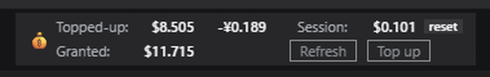
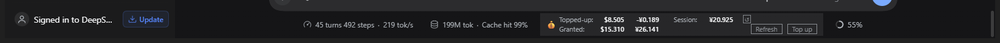

# dsh-balance-indicator

**English** · [Русский](README.ru.md)

**A DeepSeek Harness plugin that shows your account balance and the spend of the current session in
the composer dock, next to the built-in token and cache pills.**

DSH 0.2.x, MIT. Spec: `remote.account.getBalance`, slot `conversation.composer.dock`.



The row looks like this:

```
💰  Topped-up:   $8.505     -¥0.189        Session:   ¥0.000
    Granted:     $15.310    ¥47.285        [Refresh]  [Top up]
```

- **A grid, not a flow.** The row is a CSS grid of four content columns plus two service ones: the
  coin, the label, one column per currency, the `Session` label and its value. A dollar sits strictly
  under a dollar and a yuan under a yuan, and the two rows' labels start on the same vertical. There
  are no ` + ` or ` · ` separators — the alignment itself is the separator.
- **Currency order** comes from the `Topped-up` row (descending); currencies that exist only in the
  granted balance are appended after it. Both rows share the order — otherwise the columns would not
  line up.
- **`Topped-up:`** is the topped-up balance (`normal_wallets`). If every currency rounds to `0.000`,
  the largest one is shown: a zero balance is information, an empty string is not.
- **`Granted:`** is the granted balance (`bonus_wallets`). The row appears **only when it is
  non-empty**: no granted funds (or they round to `0.000`) means no row and no label, the block
  becomes single-line, and the buttons move up into the first row.
- **The symbol goes before the number** — `¥1.910`, `$8.990`. Symbols come from a small map
  (`CNY → ¥`, `USD → $`), not from `Intl`: in the English locale `Intl` prints `CN¥` and `US$`, and a
  compact sign is what we want. A currency missing from the map is shown by its code, which still
  reads fine.
- **Three decimal places.** They come from a single constant, `FRACTION_DIGITS`, and the "this is
  zero" threshold is derived from it (`ZERO_EPSILON = 0.5 · 10⁻³`), so the number of digits and the
  threshold cannot drift apart.
- **A negative balance** (overspend) is printed with the minus **before the symbol**: `-$0.010`. An
  amount below the threshold prints as an unsigned `0.000`: Platform stores many digits
  (`0.1068931130…`), and otherwise `-0.0004` would render as `-0.000`. The exact value is not lost —
  it stays in the tooltip as `Exact value`.
- **Which wallet `Session` follows** — the one that is actually being spent. The baseline is kept
  **per wallet** (key `<group>:<currency>`), because Platform may charge the session to either the
  topped-up or the granted balance. The figure comes from the wallet whose change is larger in
  absolute value; if nothing has moved yet, from the largest one, so the row never stays empty. The
  tooltip names it: `Session: ¥1.910 — Granted CNY`.
- **`reset` next to the `Session` value** zeroes the session spend. Technically it is not "zeroing a
  counter" but **moving the anchor**: every wallet's baseline is overwritten with the current
  balance — in `sessionStorage` and in the snapshot — so the next read does not return the old
  difference. It is **the word `reset` on a small fill** (10px, 11px tall — a hair above the text),
  with no border and no underline, set tight against the number (6px gap), with the tooltip
  `Reset the session spend`; in zh — `清零`. The variant was chosen from ten rendered highlight
  options: a fill gives the "button" feel without drawing an outline, and a neutral grey at alpha
  0.20 reads in both light and dark themes.
- **Currencies whose displayed balance is zero** (after rounding to `0.000`, dust bonuses included)
  do not appear in the row at all — the cell stays empty so the columns do not shift.
- **The container** is a block with **square corners** (`border-radius: 0`): this was asked for
  explicitly, and it deliberately sets the balance block apart from the dock's rounded pills.
  Typography and colour come from the same tokens the built-in token/cache pill uses
  (`--dsw-alias-label-tertiary`, `tabular-nums`), and the numbers from `--dsw-alias-label-primary`,
  so a theme switch recolours everything together with the interface.
- **`[Refresh]`** forces an update. The button is rectangular, like the block's border.
- **`[Top up]`** is a link to the Platform top-up page (`links.topUpUrl` from
  `remote.account.getState()`, falling back to `usageUrl`), a plain
  `<a href target="_blank" rel="noreferrer">` anchor with square corners. The row itself is **not** a
  link: that way clicking the buttons and going to the site do not compete for the same target.

**The subtlety that is easy to get wrong:** the coin spans both rows via `grid-row: 1 / -1`, and `-1`
only counts from an **explicit** grid. Without `grid-template-rows` the coin would occupy one cell
and the `Granted` label would slide under it, breaking the alignment. So the row count is set
explicitly — `auto auto` with a granted balance, `auto` without one.

Auto-refresh every 15 seconds.

## Checks

```
node test/smoke.mjs   # 19 checks of the browser half (vm, no DOM)
```

## Status: works

Verified in the live GUI (DSH 0.2.0-rc.2): the row renders in the composer dock and shows the
balance — at the time of that check `💰 $0.76 — $0.00 session` (USD account; the separator and the
layout have changed since, see above).

The main trap that kept the row stuck on `…`: in a client plugin you **must declare the namespaced
service**, not just the root one. This works:

```js
const inject = ['slots', 'remote', 'remote.account', 'locale']
```

With only `'remote'`, `ctx.remote.account.getBalance(...)` goes out and never gets an answer —
loading forever. The shipped `@deepseek-ai/dsh-client-ui-chat` does the same for `remote.session`.

The second fix, which takes effect after a DSH restart (the ESM module is cached): the host half
declares `export const inject = ['deepseekAccount']` — without it, touching the service in Cordis
throws and the diagnostic beacon stops after the first line.

## When the balance refreshes

| Trigger | Condition |
|---|---|
| Plugin activation | Once, on page load |
| One early retry after 2 s | If the **first** read failed (waiting for the account namespace) |
| **Every 15 seconds** | A steady interval while the tab is open |
| Clicking `↻` | Manually, at any time |
| `F5` | Anew on mount |

The refresh is **deliberately not tied to agent turns**: a turn can last for minutes, and reading at
its end would leave the figure stale for exactly that long. The loop runs strictly on a timer.

Overlapping requests are excluded: while the previous read has not finished, the next tick is
skipped. That matters because the interval (15 s) is shorter than one request's timeout (20 s) —
without the guard, requests would pile up on every stall.

Rate: one request every 15 seconds, i.e. **4 per minute** and ~5760 per day per open tab. DSH does
not cache the balance: every read is a real `GET
https://platform.deepseek.com/api/v0/users/get_user_summary` with the account token. On error the row
shows `💰 !` with the reason, and the next tick tries again.

## What "spent this session" really means

DSH has **no monetary spend accounting**: only the account balance (with currencies) and token usage
(`tokenUsage`: uncached input / output / cache read / cache write). So the second part of the row is
the **balance difference** from the first successful read on this page to now.

The baseline is taken **at the first read**, not the first render: the composer dock may mount after
page load, and anchoring to the render would lose the spend accumulated before the chat was opened.
It is kept in `sessionStorage` — **one key per wallet** (`topped:CNY`, `granted:USD`, …), so a page
reload does not reset it.

Every wallet needs a baseline because Platform does not necessarily charge the session to the
topped-up balance: on an account with granted funds the spend may come out of those, and the topped-up
balance then stands still. The session figure used to be tied to "the largest currency" — and if the
larger one was the granted wallet, which had no baseline, `Session` froze at `0.000` for the whole
session. Now the figure follows the wallet whose change is larger in absolute value, and the tooltip
names it (`Session: ¥1.910 — Granted CNY`).

Consequence: if another session or window is spending in parallel, its spend lands in this difference
too. The tooltip's label reflects that.

## Where the data comes from

- Client half: RPC `ctx.remote.account.getBalance({ version, locale, timezoneOffsetSeconds })` →
  `{ ok: true, value: { status, value: [{ currency, balance }], bonusWallets: [...] } }`, `null` when
  not signed in.
- Host half: `ctx.deepseekAccount` → `GET https://platform.deepseek.com/api/v0/users/get_user_summary`
  with the `x-dsh-auth-token` header (the token stays on the host and never reaches the browser).
- Currencies: `CNY`, `USD`. Granted wallets (`bonus_wallets`) go into the `Granted:` group, and in the
  tooltip with currency codes next to the amounts.

## Where it sits in the UI

Slot `conversation.composer.dock` (list, session-scope, "Ambient entries below the composer card").
The shipped entry is `StatsPills` from `@deepseek-ai/dsh-client-ui-chat` with `id: 'stats'`,
`order: 0`. This plugin uses `id: 'balance-indicator'`, `order: 1000`: lists are sorted by `priority`,
then by `order` **ascending**, so the block comes last and replaces nothing.



**The limit of what is possible.** To the right of the dock in the same line sits the context meter
(`ContextMeter`, the "43%"), and the composer renders it **after** the slot, not inside it:

```js
children: [
  renderSlot('conversation.composer.dock', {}),
  activity ? null : ContextMeter({ ... }),
]
```

So no `order` can put you to the right of the meter — you can only be the last entry in the dock.
While a turn is running the meter is hidden (`activity ? null : …`), and then the block is the
rightmost element in the row.

## Layout

| File | Role |
|---|---|
| `package.json` | declares `dsh.bundle.patch` and `dsh.client` (`platform: web`, `immediately`) |
| `cordis.patch.yml` | inserts the plugin row into the profile composition |
| `index.js` | host half: empty, needed only for the loader row to exist |
| `client.js` | browser half: a CJS factory in `window.__ModuleLoader__`, React from the shell's seed table |

## Install

```powershell
# 1. the package lives outside the profile; point at it with file:
#    %USERPROFILE%\.dsh\profiles\desktop\package.json
#    "dsh-balance-indicator": "file:../../local-plugins/dsh-balance-indicator"
#    and add the name to "dsh.profile.bundles"
# 2. link it
cd "$env:USERPROFILE\.dsh\profiles\desktop"
pnpm install --prefer-offline
```

## Activation

The profile composition is read by the host at startup, so after editing `package.json` by hand you
need one of:

1. **Without a restart:** sidebar → **Plugins** → toggle `dsh-balance-indicator` off and on (the
   plugin manager recomposes the tree live via HMR).
2. Or restart DSH.

After that, edits to `client.js` are picked up live: HMR polling checks the file every 500 ms.
Editing `index.js` of an already installed package needs a restart.

## Tests

```powershell
node test/smoke.mjs
```

The smoke test loads `client.js` in `node:vm` with a fake `window.__ModuleLoader__`, calls the
factory and `apply` with a fake client context, and checks: wallet mapping, money formatting, the
dropdown appearing only with several currencies, the delta against the baseline, the "not signed in" /
"remote error" / "exception" / "no namespace" branches, and that every effect returns a cleanup.
React is stubbed, so React rendering itself is not covered — this tests the plugin's logic, not the
layout.

## Checking the composition (without launching the GUI)

The CLI does not expose the stock `desktop` profile (`managed exclusively by the Electron
application`), so the check runs against a throwaway copy of the profile:

```powershell
$prof = "$env:USERPROFILE\.dsh\profiles\desktop"
$dst  = "$env:USERPROFILE\.dsh\profiles\plugin-check"
New-Item -ItemType Directory -Path $dst -Force | Out-Null
foreach ($f in @('package.json','cordis.yml','cordis.patch.yml','pnpm-lock.yaml','compatibility.json','pnpm-workspace.yaml')) {
  Copy-Item "$prof\$f" $dst -Force -ErrorAction SilentlyContinue
}
cmd /c "mklink /J `"$dst\node_modules`" `"$prof\node_modules`""

& dsh --profile plugin-check --dump-config |
  Select-String -Pattern 'balance-indicator' -Context 2,1

# cleanup: rmdir without /S removes only the junction, the target's contents stay
cmd /c "rmdir `"$dst\node_modules`""
Remove-Item $dst -Recurse -Force
```

The tree should contain:

```
# == dsh-balance-indicator
- id: balance-indicator
  name: dsh-balance-indicator
```

## Troubleshooting

- Row missing → check in **Plugins** that the bundle is enabled and shows no error status.
- `💰 !` with an error tooltip → the host could not answer (signed out, no network, Platform error).
- `💰 —` → no account connected (no grant in `.credentials.yaml`).
- Shows nothing but no errors → the tab is open outside a chat session: the slot only exists inside
  the composer.
